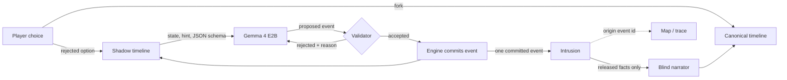

# After the Knock

*(working title)*

A short horror story where the choice you didn't make keeps happening in a hidden timeline, and its events start appearing in yours as evidence you can trace.

**The idea:** a horror game that simulates rejected choices as separate worlds and lets their recorded events manifest as evidence in the player's chosen reality.

Branching horror, timelines that remember, and AI-generated branching stories all exist already (see [Prior art](#prior-art)). This project combines three things: rejected branches that keep simulating, intrusions that carry facts created after the fork, and inspectable provenance for every intrusion.

It is 11:47 PM. A storm. A woman you have never met knocks on your door and says, *"Please. You already let me in."* Lock the door, and later you find four digits written on the thing in your pocket. Mara wrote them, in the night where you opened the door. Later, in the basement, those digits open the padlock on unit 07. And once more before the night ends, you hear a voice from the stairwell saying words that were only ever spoken in the other night. Both crossings trace back to the exact events that made them.

<!-- GIF: owner records from scripts/demo -->

## Play it

- **Recorded nights in your browser:** https://knock-replay.onrender.com/ shows replays of real local runs (the model is not running live).

## Run it

You need [uv](https://docs.astral.sh/uv/) and, for live play, [Ollama](https://ollama.com) with a GPU that has about 4 GB free.

```bash
scripts/setup            # uv sync, pull gemma4:e2b if missing, run the tests
uv run knock-server      # open http://localhost:8047
```

No GPU? Recorded runs play without a model:

```bash
uv run knock-server --replay-only
```

Terminal version: `uv run knock play`.

### What runs where

| Mode | What happens | Needs |
|---|---|---|
| **Local live** (default: `knock-server`) | Shadow timelines are generated during your playthrough by Gemma 4 E2B on your own GPU, offline. This is the mode the evaluation measures. | Ollama + `gemma4:e2b` |
| **Hosted live** (`render.yaml` service `knock-live`, *tested against the real endpoint, not yet deployed*) | The same engine and front end on Render. Model calls go to **Gemma 4 31B (`gemma-4-31B-it`), an open-weight model on DigitalOcean serverless inference**, through its OpenAI-compatible API. That is a bigger model than the local default, so its numbers are reported separately and never mixed into the results below. Spend is capped (default $10) and logged per playthrough. If the endpoint is down or the cap is reached, the page switches to the labeled replays. | Configured by the deployer (`.env.example`) |
| **Replay site** (static, `site/`, [knock-replay.onrender.com](https://knock-replay.onrender.com/)) | Plays committed recordings of real local runs. Every screen says **"Replay of a real recorded run — the model is not running live."** Nothing is generated. When the site is built, each recording is re-run through the engine from its recorded model outputs, and the build fails if any timeline's state hash differs. Choices follow the recording. | A browser |
| **Replay via the server** (`knock-server --replay-only`) | The same recordings, re-executed by the engine when you play them, labeled the same way. | Python |
| **Evaluation** (`eval/run_all.py`) | Fresh local live runs, or `--from-results` to recompute every number from the saved raw logs. | Ollama for fresh runs |

Rebuild the replay site after re-recording: `uv run python scripts/build_static.py`. A test fails if `site/` is out of date.

No closed-model API is called anywhere. The hosted mode is selected only by environment variables (`KNOCK_PROVIDER=openai` plus `KNOCK_OPENAI_*`). Without them, everything runs locally.

## How it works



**Branching rule.** Fork 1 (open or lock the door) creates your timeline A and a shadow B. Fork 2 (basement or roof) splits A into your timeline C and a shadow D. B and D are the only shadows. Each runs a fixed budget of 3 or 4 events, then freezes. Your timeline receives exactly one intrusion from each.

**The model proposes; the engine commits.** For each shadow event, Gemma gets the shadow's current state and a one-line story beat, and must answer in a JSON schema: actor, action (one of move, speak, give, take, mark, open, hide, discover, harm), target, recipient, text, summary. It never writes state. A deterministic validator checks the proposal against the shadow's state: people and things exist in that branch, you can only give, mark or hide what you hold, you must be in the same place, moves go one step to an adjacent place, locked places need their key, the dead and departed don't act. If the proposal passes, the engine derives the state change from the action's rules and commits it. If it fails, the model gets the reason and tries again, up to three times. After that a hand-written fallback event is committed. Every rule has a unit test.

**Intrusions cite their origin.** An intrusion links one committed shadow event to a change in your timeline. The engine refuses an intrusion unless the origin is a committed, simulated event of that shadow and it reveals at least one fact that did not exist at the fork, such as the digits that were written on your object. Echoing your own input back does not count. The two crossings must differ: the first is something *written* (a mark on an object) and the second is something *heard* (words spoken in the shadow). The engine refuses a later crossing that repeats an earlier crossing's object or sense, or that shows the pocket object again. During play, asking where a crossing came from gives only a short hint built from the source event ("Your apartment, with the door open. A pen. Her hand."). At the end, the map draws a thread from every crossing to its origin event. Click either end to see the proposal, every rejected attempt, the validator's decision and the facts that crossed. The **evidence** switch shows all of this at any time.

**Crossings are told with hand-written lines; the model adds at most one sentence.** The words around each crossing are hand-written templates with the committed facts slotted in: the inscription, the object, whose hand or voice. The model may add one sentence of atmosphere. The prompt for that sentence is built only from your timeline (where you are, who is with you). It never sees the shadow log or the inscription, so it cannot contradict or leak either. The sentence is rule-checked (one sentence, no numbers, names, quotes, ALL-CAPS words or banned phrases), retried once, and dropped if it still fails.

**Banned phrases.** Horror clichés such as "help me", "get out" and "you're next" are rejected wherever the model writes text, both in shadow proposals and in the atmosphere sentence.

**Reproducible.** Each run records the seed, model and quantization, a hash of every prompt, every proposal and validator decision, and every committed event. Replaying a log through the engine reproduces every timeline's state hash. The test suite checks this, and checks that a tampered log fails.

## Results

<!-- RESULTS:BEGIN -->
Model: gemma4:e2b Q4_K_M, 24 live playthroughs (every fork path), raw logs in `eval/results/runs/`.

| Measurement | Result |
|---|---|
| Unintended state crossings | 0 |
| Narrator saw unreleased shadow text | 0 |
| Intrusions revealing a post-fork fact | 48/48 (100%) |
| Intrusions with valid origin event | 48/48 (100%) |
| Replays reproducing every state hash | 24/24 (100%) |
| Shadow events accepted on the model's first proposal | 114/156 (73%) |
| Shadow events committed from the model | 146/156 (94%) |
| Shadow events from hand-written fallback | 9/156 (6%) |
| Proposals rejected by the validator | 67/213 (31%) |
| Deliberate impossible give rejected | 30/30 (100%) |
| Model's atmosphere sentence failing rule checks (first attempt) | 0/48 (0%) |
| Crossings that kept a model sentence (rest: hand-written lines only) | 48/48 (100%) |
| Narration contradictions, hand-labeled | not labeled |
| Intrusion accuracy, hand-labeled | not labeled |
| Model call latency p50 / p95 | 1.78 s / 2.09 s |
| Whole shadow timeline p50 / p95 | 7.15 s / 9.52 s |
| Model calls per playthrough (mean) | 10.9 |
| Tokens per playthrough (mean) | 6389 |

Variation (same choices, different seeds):

| Path | Runs | Distinct event chains | Mean pairwise overlap (Jaccard) |
|---|---|---|---|
| lock/basement | 6 | 6 | 0.31 |
| lock/roof | 6 | 6 | 0.23 |
| open/basement | 6 | 6 | 0.28 |
| open/roof | 6 | 6 | 0.37 |

Rejections by rule: R_REACH 28, R_NOOP 18, R_ADJACENT 10, R_TYPE 6, R_BEAT 5.

Notes on these numbers:

- A *shadow step* is one shadow event: up to three model proposals, then a hand-written fallback. 1 of 156 steps was skipped (the model failed and no fallback fitted the state). Every shadow still ended with its committed crossing.
- "Rejected" counts proposals stopped by the validator or by a story-beat check (`R_BEAT`, which includes banned phrases). A rejected proposal never changes state.
- The crossing text is hand-written around the committed facts. The atmosphere-sentence rows measure only the model's optional extra sentence, which is rule-checked. That doesn't prove the sentence never contradicts anything; hand labels go in `eval/labels/` and show as "not labeled" until a person fills them in.
- Time from the click to the crossing, with no reading pause at all: p50 7.69 s, p95 10.15 s. In real play the shadow runs while you read the scenes before it.
<!-- RESULTS:END -->

### Hosted model, reported separately

These numbers come from a small separate run of the same engine, with `gemma-4-31B-it` (Gemma 4 31B, open-weight) on DigitalOcean serverless inference. It's a bigger model than the local default, so none of these numbers feed the headline results above. 8 playthroughs, 2 seeds per fork path, `uv run python eval/run_all.py --hosted --seeds 2`, raw logs in `eval/results/hosted/runs/`, spend ledger in `eval/results/spend.json`.

Model: gemma-4-31B-it provider-managed, 8 live playthroughs (every fork path), raw logs in `eval/results/hosted/runs/`.

| Measurement | Result |
|---|---|
| Unintended state crossings | 0 |
| Narrator saw unreleased shadow text | 0 |
| Intrusions revealing a post-fork fact | 16/16 (100%) |
| Intrusions with valid origin event | 16/16 (100%) |
| Replays reproducing every state hash | 8/8 (100%) |
| Shadow events accepted on the model's first proposal | 44/52 (85%) |
| Shadow events committed from the model | 48/52 (92%) |
| Shadow events from hand-written fallback | 4/52 (8%) |
| Proposals rejected by the validator | 16/64 (25%) |
| Deliberate impossible give rejected | 30/30 (100%) |
| Model's atmosphere sentence failing rule checks (first attempt) | 0/16 (0%) |
| Crossings that kept a model sentence (rest: hand-written lines only) | 16/16 (100%) |
| Narration contradictions, hand-labeled | not labeled |
| Intrusion accuracy, hand-labeled | not labeled |
| Model call latency p50 / p95 | 1.67 s / 2.9 s |
| Whole shadow timeline p50 / p95 | 6.83 s / 11.81 s |
| Model calls per playthrough (mean) | 10 |
| Tokens per playthrough (mean) | 5616 |

Variation (same choices, different seeds):

| Path | Runs | Distinct event chains | Mean pairwise overlap (Jaccard) |
|---|---|---|---|
| lock/basement | 2 | 2 | 0.09 |
| lock/roof | 2 | 2 | 0.2 |
| open/basement | 2 | 2 | 0.27 |
| open/roof | 2 | 2 | 0.4 |

Rejections by rule: R_NOOP 12, R_ADJACENT 2, R_REACH 2.

Spend: $0.00911 over 8 playthroughs (mean $0.00114 each) at $0.18/$0.5 per 1M input/output tokens.

The ledger in `spend.json` also covers health checks, probes and earlier runs. Two seeds per path is too few to compare models; this run shows only that hosted mode works end to end and holds the same invariants.

Every number above comes from `uv run python eval/run_all.py` (or `--from-results` to recompute from the committed raw logs). Charts: `eval/results/chart_*.svg`. Model choice and the day-one benchmark: [MODELS.md](MODELS.md).

## Why open models

The same open-weight family runs in both live modes. Gemma 4 E2B runs locally on a consumer GPU, and Gemma 4 31B is hosted for people without one.

- **Many background calls.** Each playthrough makes about 11 model calls (about 6,400 tokens) that the player never sees directly, and most of them happen in a world the player never visits. Locally they cost nothing and need no account. Hosted, they cost about a tenth of a cent per playthrough at the listed price ($0.18 / $0.50 per million input / output tokens), which an open model makes possible at hobby scale.
- **Pinned weights.** The validator, prompts and fallback rates were tuned against one exact local model file (digest in MODELS.md). A closed model that changed underneath would silently change how often the story falls back. With open weights, the local mode can always be checked against the same file.
- **Inspectable.** In local mode the whole simulation runs on your machine: model, prompts, proposals, rejections and commits. In both modes the evidence view (press `E`) shows every proposal and validator decision.

## Tests

```bash
uv run pytest
```

Covered: every validator rule, the branching rule, idempotent retries, branch isolation, the post-fork-fact rule, the provenance invariant, the blind narrator, the impossible-action rejection, replay reproduction and tamper detection, narration fallback, and all eight story paths with a model that never answers usefully.

## Layout

```
knock/      engine.py (timelines, forks, intrusions), validator.py, sim.py (shadow simulation),
            narrator.py (blind narrator), game.py (scenes, endings), audit.py (invariants),
            models.py (Ollama, replay), api.py (HTTP server), cli.py
web/        browser game, map, trace drawer, evidence view
data/story/ world, scenes, endings, shadow beats and fallback events (hand-written)
data/runs/replays/  recorded runs for replay mode
eval/       run_all.py, kill_test.py, bench_models.py, results/
scripts/    setup, demo
```

## Prior art

Rejected branches, alternate timelines and memory across branches are well explored in games, tools and research. This project is related work, not a first. What it adds is one combination: rejected branches that keep simulating, intrusions that carry facts created after the fork, and inspectable provenance for every intrusion.

- *Undertale* (Toby Fox, 2015): the game remembers what you did in runs you reset.
- *Slay the Princess* (Black Tabby Games, 2023): branching horror where earlier choices reshape later loops.
- *Until Dawn* (Supermassive Games, 2015): branching horror with consequences tracked across a night.
- [ECHO](https://github.com/kishore1035/ECHO): a voice-command game where rewriting reality splits the world into alternate branches, and one character remembers the erased timelines. It uses Google Gemini to parse commands.
- [BRING](https://github.com/Eva-E1/BRING) (Apache-2.0): an LLM role-play framework that can create, switch and merge branches for alternate storylines.
- WHAT-IF (arXiv [2412.10582](https://arxiv.org/abs/2412.10582)): branching interactive fiction generated with LLMs.
- Narrative Studio (arXiv [2504.02426](https://arxiv.org/abs/2504.02426)): exploring branching story trees with LLMs.

## Credits

- Model: Gemma 4 E2B (Google), Apache 2.0, run through [Ollama](https://ollama.com).
- No third-party code is vendored. The web front end and the sound (generated with the Web Audio API) are written for this project.
- All characters and places are fictional.

## Commits after deadline

None yet. Any commit after Oct 31, 2026, 11:59 PM PDT will be listed here.

## License

Apache 2.0. See [LICENSE](LICENSE).
