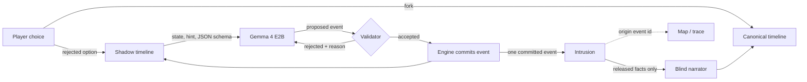

# After the Knock

*(working title)*

A short horror story where the choice you didn't make keeps happening in a hidden timeline, and its events start appearing in yours as evidence you can trace.

**What's new here:** a horror game that simulates rejected choices as separate worlds and lets their recorded events manifest as evidence in the player's chosen reality.

Branching horror, timelines that remember, and AI-generated branching stories all exist already (see [Prior art](#prior-art)). This project combines three things: rejected branches that keep simulating, intrusions that carry facts created after the fork, and inspectable provenance for every intrusion.

It is 11:47 PM. A storm. A woman you have never met knocks on your door and says, *"Please. You already let me in."* Lock the door, and later you find four digits written on the thing in your pocket. Mara wrote them, in the night where you opened the door. Click the digits and the game shows you the event that wrote them.

<!-- GIF: owner records from scripts/demo -->

## Run it

You need [uv](https://docs.astral.sh/uv/) and, for live play, [Ollama](https://ollama.com) with a GPU that has about 4 GB free.

```bash
scripts/setup            # uv sync, pull gemma4:e2b if missing, run the tests
uv run knock-server      # open http://localhost:8047
```

No GPU? Recorded runs play without a model:

```bash
uv run knock-server --replay-only
```

Terminal version: `uv run knock play`.

### What runs where

| Mode | What happens | Needs |
|---|---|---|
| **Live** (`knock-server`) | Shadow timelines are generated during your playthrough by Gemma 4 E2B on your machine. | Ollama + `gemma4:e2b` |
| **Replay** (`--replay-only`, or the list on the title screen) | A recorded real run. The engine re-runs it from the recorded model outputs and checks that every timeline's state hash matches the recording. Labeled *replay* on screen. Nothing is generated. | Nothing |
| **Evaluation** (`eval/run_all.py`) | Fresh live runs, or recomputation from the saved raw logs with `--from-results`. | Ollama for fresh runs |

No closed-model API is called anywhere.

## How it works



**Branching rule.** Fork 1 (open or lock the door) creates your timeline A and a shadow B. Fork 2 (basement or roof) splits A into your timeline C and a shadow D. B and D are the only shadows. Each runs a fixed budget of 3 or 4 events, then freezes. Your timeline receives exactly one intrusion from each.

**The model proposes; the engine commits.** For each shadow event, Gemma gets the shadow's current state and a one-line story beat, and must answer in a JSON schema: actor, action (one of move, speak, give, take, mark, open, hide, discover, harm), target, recipient, text, summary. It never writes state. A deterministic validator checks the proposal against the shadow's state: people and things exist in that branch, you can only give, mark or hide what you hold, you must be in the same place, moves go one step to an adjacent place, locked places need their key, the dead and departed don't act. If the proposal passes, the engine derives the state change from the action's rules and commits it. If it fails, the model gets the reason and tries again, up to three times. After that a hand-written fallback event is committed. Every rule has a unit test.

**Intrusions cite their origin.** An intrusion links one committed shadow event to a change in your timeline. The engine refuses an intrusion unless the origin is a committed, simulated event of that shadow and it reveals at least one fact that did not exist at the fork, such as the digits that were written on your object. Echoing your own input back does not count. The map draws a thread from every intrusion to its origin event. Click either end to see the proposal, every rejected attempt, the validator's decision and the facts that crossed.

**The narrator is blind.** The model that writes the moment of an intrusion sees only your timeline's state and the facts that intrusion released. It never sees shadow logs, so it cannot leak anything early. Its text is checked by rules: the inscription must appear exactly, no invented numbers or capitalised words, no character who isn't there, the object must be named. It gets one retry, then hand-written text is used. These checks cover the critical facts. They do not prove that the prose is free of every contradiction (see the hand-labeled numbers below).

**Reproducible.** Each run records the seed, model and quantization, a hash of every prompt, every proposal and validator decision, and every committed event. Replaying a log through the engine reproduces every timeline's state hash. The test suite checks this, and checks that a tampered log fails.

## Results

<!-- RESULTS:BEGIN -->
*Pending: filled from `eval/results/summary.md`.*
<!-- RESULTS:END -->

Every number above comes from `uv run python eval/run_all.py` (or `--from-results` to recompute from the committed raw logs). Charts: `eval/results/chart_*.svg`. Model choice and the day-one benchmark: [MODELS.md](MODELS.md).

## Why open models

- **Many background calls.** Each playthrough makes dozens of model calls that the player never sees directly. Running locally, they cost nothing and need no account.
- **Pinned weights.** The validator, the prompts and the fallback rates were tuned against one exact model file (digest in MODELS.md). A hosted model that changes underneath would silently change how often the story falls back.
- **Inspectable.** The whole simulation runs on your machine: model, prompts, proposals, rejections and commits. The evidence view (press `E`) shows all of it.

## Tests

```bash
uv run pytest
```

Covered: every validator rule, the branching rule, idempotent retries, branch isolation, the post-fork-fact rule, the provenance invariant, the blind narrator, the impossible-action rejection, replay reproduction and tamper detection, narration fallback, and all eight story paths with a model that never answers usefully.

## Layout

```
knock/      engine.py (timelines, forks, intrusions), validator.py, sim.py (shadow simulation),
            narrator.py (blind narrator), game.py (scenes, endings), audit.py (invariants),
            models.py (Ollama, replay), api.py (HTTP server), cli.py
web/        browser game, map, trace drawer, evidence view
data/story/ world, scenes, endings, shadow beats and fallback events (hand-written)
data/runs/replays/  recorded runs for replay mode
eval/       run_all.py, kill_test.py, bench_models.py, results/
scripts/    setup, demo
```

## Prior art

Rejected-branch and memory mechanics have a long history in games and research. This project builds on, and does not claim to replace:

- *Undertale* (Toby Fox, 2015): the game remembers what you did in runs you reset.
- *Slay the Princess* (Black Tabby Games, 2023): branching horror where earlier choices reshape later loops.
- *Until Dawn* (Supermassive Games, 2015): branching horror with consequences tracked across a night.
- ECHO.
- BRING.
- WHAT-IF (arXiv [2412.10582](https://arxiv.org/abs/2412.10582)): branching interactive fiction generated with LLMs.
- Narrative Studio (arXiv [2504.02426](https://arxiv.org/abs/2504.02426)): exploring branching story trees with LLMs.

## Credits

- Model: Gemma 4 E2B (Google), Apache 2.0, run through [Ollama](https://ollama.com).
- No third-party code is vendored. The web front end and the sound (generated with the Web Audio API) are written for this project.
- All characters and places are fictional.

## Commits after deadline

None yet. Any commit after Oct 31, 2026, 11:59 PM PDT will be listed here.

## License

Apache 2.0. See [LICENSE](LICENSE).
