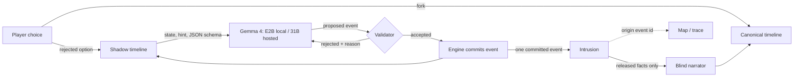

# After the Knock

*The night you didn't choose is still happening.*

A short horror story where the choice you didn't make keeps happening in a hidden timeline, and its events start appearing in yours as evidence you can trace.

**The idea:** a horror game that simulates rejected choices as separate worlds and lets their recorded events manifest as evidence in the player's chosen reality.

Branching horror, timelines that remember, and AI-generated branching stories all exist already (see [Prior art](#prior-art)). This project combines three things: rejected branches that keep simulating, intrusions that carry facts created after the fork, and inspectable provenance for every intrusion.

It is 11:47 PM. A storm. A woman you have never met knocks on your door and says, *"Please. You already let me in."* Lock the door, and later you find four digits written on the thing in your pocket. Mara wrote them, in the night where you opened the door. Follow Mara down to the basement and those digits open the padlock on unit 07; trust Teo and go up to the roof, and he calls up from his window and tells you what he heard in March, and what the numbers open. Then a second object turns up with a message on it, in your own handwriting, written in a night you never lived. Both crossings trace back to the exact events that made them. Then three knocks come at a door that looks exactly like yours, and the person on the other side is you: the one who made the other choice.

<!-- GIF: owner records from scripts/demo (steps below, under "Recording the demo"). -->

## Play it

- **Play live in your browser:** https://knock-live.onrender.com/ is live: the other nights are generated as you play by Gemma 4 31B on DigitalOcean serverless inference. If the model ever becomes unavailable or the spend cap is reached, the page says so and offers the recorded nights instead; `https://knock-live.onrender.com/api/status` shows which mode it is in.
- **Recorded nights:** https://knock-replay.onrender.com/ shows replays of real hosted runs, recorded with Gemma 4 31B (the model is not running there).

## Run it

You need [uv](https://docs.astral.sh/uv/) and, for live play, [Ollama](https://ollama.com) with a GPU that has about 4 GB free.

```bash
scripts/setup            # uv sync, pull gemma4:e2b if missing, run the tests
uv run knock-server      # open http://localhost:8047
```

No GPU? Recorded runs play without a model:

```bash
uv run knock-server --replay-only
```

Terminal version: `uv run knock play`.

### What runs where

| Mode | What happens | Needs |
|---|---|---|
| **Local live** (default: `knock-server`) | Shadow timelines are generated during your playthrough by Gemma 4 E2B on your own GPU, offline. This is the mode the evaluation measures. | Ollama + `gemma4:e2b` |
| **Hosted live** ([knock-live.onrender.com](https://knock-live.onrender.com/), `render.yaml` service `knock-live`) | The same engine and front end on Render. Model calls go to **Gemma 4 31B (`gemma-4-31B-it`), an open-weight model on DigitalOcean serverless inference**, through its OpenAI-compatible API. That is a bigger model than the local default, so its numbers are reported separately and never mixed into the results below. Spend is capped (default $10) and logged per playthrough. If the endpoint is down or the cap is reached, the page switches to the labeled replays. | Configured by the deployer (`.env.example`) |
| **Replay site** (static, `site/`, [knock-replay.onrender.com](https://knock-replay.onrender.com/)) | Plays committed recordings of real hosted runs (Gemma 4 31B), one per route pair, copied from `eval/results/hosted/runs/` by `scripts/replays_from_hosted.py`; local runs stay in the eval. The landing says **"These nights were recorded earlier. The model isn't running here."**, and every recorded night carries a **RECORDED NIGHT** tag. Nothing is generated. When the site is built, each recording is re-run through the engine from its recorded model outputs, and the build fails if any timeline's state hash differs. Choices follow the recording. | A browser |
| **Replay via the server** (`knock-server --replay-only`) | The same recordings, re-executed by the engine when you play them, labeled the same way. | Python |
| **Evaluation** (`eval/run_all.py`) | Fresh local live runs, or `--from-results` to recompute every number from the saved raw logs. | Ollama for fresh runs |

Rebuild the replay site after re-recording: `uv run python scripts/build_static.py`. A test fails if `site/` is out of date.

No closed-model API is called anywhere. The hosted mode is selected only by environment variables (`KNOCK_PROVIDER=openai` plus `KNOCK_OPENAI_*`). Without them, everything runs locally.

**Hosted spend limits.** The real cap is the DigitalOcean prepaid balance: serverless inference stops when it runs out. The app adds three guards. A ledger cap (default $10) is checked before every call, but its file lives on Render's temporary disk and resets whenever the service restarts. A per-process hourly ceiling (default $1) is held in memory, so it doesn't depend on that file. And new live games are limited to 20 per client and 60 per hour overall; replay starts have the same limits, counted separately.

**What you type.** Empty or abstract answers ("nothing", "regret", "a promise") become an old ticket stub, and the opening says so; long answers are shortened; markup is dropped; everything is shown as text.

**Your pocket text.** Live runs store what you type as your pocket object on the server's temporary disk (in the run log), and nowhere else; it is wiped when the server restarts. In hosted mode it is also part of the prompts sent to the inference provider (DigitalOcean) to generate the other night. In local mode it never leaves your machine.

## How it works



**Branching rule.** Fork 1 (open or lock the door) creates your timeline A and a shadow B. Fork 2 (basement or roof) splits A into your timeline C and a shadow D. B and D are the only shadows. Each runs a fixed budget of 3 or 4 events, then freezes. Your timeline receives exactly one intrusion from each.

**The model proposes; the engine commits.** For each shadow event, Gemma gets the shadow's current state and a one-line story beat, and must answer in a JSON schema: actor, action (one of move, speak, give, take, mark, open, hide, discover, harm), target, recipient, text, summary. It never writes state. A deterministic validator checks the proposal against the shadow's state: people and things exist in that branch, you can only give, mark or hide what you hold, you must be in the same place, moves go one step to an adjacent place, locked places need their key, the dead and departed don't act. If the proposal passes, the engine derives the state change from the action's rules and commits it. If it fails, the model gets the reason and tries again, up to three times. After that a hand-written fallback event is committed. Every rule has a unit test.

**Intrusions cite their origin.** An intrusion links one committed shadow event to a change in your timeline. The engine refuses an intrusion unless the origin is a committed, simulated event of that shadow and it reveals at least one fact that did not exist at the fork, such as the digits that were written on your object. Echoing your own input back does not count. Only marks manifest: a crossing is always something written on an object. The two crossings must land on different objects, and the engine refuses a later crossing that marks an object an earlier one already used. The first lands on your pocket object if you locked the door, or on the brass key's paper tag if you opened it; the second uses the other one. Click a crossing, during play or on the map, and you first get a flashback of the other night: a few lines rendered from hand-written templates over the events actually committed in that shadow, ending on the mark itself ("She takes the photo of your sister from the other you. / She writes “0921” across it."), then *written there → appeared here*. A test checks that every action in a flashback is a committed event of that shadow. A **View proof** disclosure underneath holds the event IDs, every rejected attempt, the validator's decisions and the raw proposals. After the ending, **Explore the nights you didn't live** opens the map: it reveals every branch at its actual choice, draws a thread from each crossing to its origin event, and walks you to the first crossing. **See how this haunting was generated and verified** opens the evidence view: the full audit, every proposal, rejection and commit, plus what changed between the nights. On the live server the map and the evidence return 403 until the night has ended, because the full log would give the other night away before it crosses; each crossing's own trace is available as soon as it appears. On the replay site the recordings are ordinary public files, so nothing there is hidden from someone who opens them; the page simply doesn't show the map or the log until the end.

**Crossings are told with hand-written lines; the model adds at most one sentence.** The words around each crossing are hand-written templates with the committed facts slotted in: the inscription, the object, whose handwriting. The model may add one sentence of atmosphere. The prompt for that sentence is built only from your timeline (where you are, who is with you). It never sees the shadow log or the inscription, so it cannot contradict or leak either. The sentence is rule-checked (one sentence, no numbers, names, quotes, ALL-CAPS words or banned phrases), retried once, and dropped if it still fails.

**Banned phrases.** Horror clichés such as "HELP ME", "GET OUT", "YOU'RE NEXT", "RUN" and "BEHIND YOU" are rejected (`R_BEAT`) wherever the model writes text, both in shadow proposals and in the atmosphere sentence. The second crossing is your other self's message to you: one to three words, in your own hand, built only from a fixed vocabulary of the building, its people and plain words; a word mark that isn't readable, or is only a place name (STAIRWELL, ROOF, DOOR…), is rejected with the reason.

**Endings agree with committed state.** The endings name the marks that crossed and who made them, and echo both of your choices. Where each object and Mara ended up is in the evidence view, under **Where the two nights diverged**: two columns, *Your night* and *The night you rejected*, from committed state in each ("It was in your hand." / "It was in your other self's hand."). A test checks this over every recorded and evaluated run, and another checks that no internal identifier ever reaches player-facing text. The climax is authored, and labelled as such. Straight after the second crossing, the other you (the protagonist of the opposite first choice) knocks at a door exactly like yours and speaks through it. The scene states only your own choices, inverted; facts from committed events of that other night, chosen by conditions on the log (a test checks every stated fact against the log, and leaves a line out when no event supports it); whether Mara is beside you in your own night; and the story's backstory. It adds no events, and the evidence view labels it "Authored scene, built from your choices and the logged events of the other night." One line in it can be the model's own words: if, in that other night, Mara said something the other you heard (to them, aloud in their room, or in the hall while they listened at the door), and that line was a committed model proposal, not a fallback, that passes the banned-phrase and cut-off checks and is at most 80 characters, the other you repeats it ("She asked me, 'You still carry her picture, don't you?' I didn't know what she meant."). The evidence view names that line and links to the exact proposal it came from. With no such event, the line is left out.

In the evidence panel, "Re-run this night through the engine" feeds the night's log back through the engine and compares every timeline's state hash. The replay site has no engine in the browser, so there each recording is re-run when the site is built, and the build fails if one does not reproduce.

**Reproducible.** Each run records the seed, model and quantization, a hash of every prompt, every proposal and validator decision, and every committed event. Replaying a log through the engine reproduces every timeline's state hash. The test suite checks this, and checks that a tampered log fails.

## Results

<!-- RESULTS:BEGIN -->
Model: gemma4:e2b Q4_K_M, 24 live playthroughs (every fork path), raw logs in `eval/results/runs/`.

| Measurement | Result |
|---|---|
| Unintended state crossings | 0 |
| Narrator saw unreleased shadow text | 0 |
| Intrusions revealing a post-fork fact | 48/48 (100%) |
| Intrusions with valid origin event | 48/48 (100%) |
| Replays reproducing every state hash | 24/24 (100%) |
| Shadow events accepted on the model's first proposal | 145/162 (90%) |
| Shadow events committed from the model | 161/162 (99%) |
| Shadow events from hand-written fallback | 1/162 (1%) |
| Proposals rejected by the validator | 21/182 (12%) |
| Deliberate impossible give rejected | 30/30 (100%) |
| Model's atmosphere sentence, first attempt | 2 rejected by checks, 0 provider errors; 48/48 crossings kept a sentence |
| Narration contradictions, hand-labeled | not labeled |
| Intrusion accuracy, hand-labeled | not labeled |
| Model call latency p50 / p95 | 1.85 s / 2.97 s |
| Whole shadow timeline p50 / p95 | 7.19 s / 9.5 s |
| Model calls per playthrough (mean) | 9.7 |
| Tokens per playthrough (mean) | 6177 |

Variation (same choices, different seeds):

| Path | Runs | Distinct event chains | Mean pairwise overlap (Jaccard) |
|---|---|---|---|
| lock/basement | 6 | 6 | 0.29 |
| lock/roof | 6 | 6 | 0.33 |
| open/basement | 6 | 6 | 0.3 |
| open/roof | 6 | 6 | 0.38 |

Rejections by rule: R_REACH 11, R_TYPE 7, R_BEAT 3.

Freedom vs. guarantees, per shadow step (committed by the model or by a hand-written fallback; distinct action types and distinct texts across runs). Crossing 2 written by the player: 24/24 (100%).

| Shadow | Step | Model | Fallback | Skipped | Actions | Distinct texts |
|---|---|---|---|---|---|---|
| B.lock | 1 | 11 | 1 | 0 | open | 0 |
| B.lock | 2 | 12 | 0 | 0 | move | 0 |
| B.lock | 3 | 12 | 0 | 0 | speak | 11 |
| B.lock | 4 | 12 | 0 | 0 | mark | 11 |
| B.open | 1 | 12 | 0 | 0 | speak | 12 |
| B.open | 2 | 12 | 0 | 0 | take | 0 |
| B.open | 3 | 12 | 0 | 0 | mark | 9 |
| D.lock.basement | 1 | 6 | 0 | 0 | speak | 2 |
| D.lock.basement | 2 | 6 | 0 | 0 | take | 0 |
| D.lock.basement | 3 | 6 | 0 | 0 | mark | 3 |
| D.lock.roof | 1 | 6 | 0 | 0 | move | 0 |
| D.lock.roof | 2 | 6 | 0 | 0 | speak | 4 |
| D.lock.roof | 3 | 6 | 0 | 0 | give, take | 0 |
| D.lock.roof | 4 | 6 | 0 | 0 | mark | 4 |
| D.open.basement | 1 | 6 | 0 | 0 | open, speak | 1 |
| D.open.basement | 2 | 6 | 0 | 0 | move | 0 |
| D.open.basement | 3 | 6 | 0 | 0 | mark | 4 |
| D.open.roof | 1 | 6 | 0 | 0 | speak | 5 |
| D.open.roof | 2 | 6 | 0 | 0 | give | 0 |
| D.open.roof | 3 | 6 | 0 | 0 | mark | 4 |

Notes on these numbers:

- A *shadow step* is one shadow event: up to three model proposals, then a hand-written fallback. 0 of 162 steps were skipped (the model failed and no fallback fitted the state). Every shadow still ended with its committed crossing.
- "Rejected" counts proposals stopped by the validator or by a story-beat check (`R_BEAT`, which includes banned phrases). A rejected proposal never changes state.
- The crossing text is hand-written around the committed facts. The atmosphere-sentence row measures only the model's optional extra sentence, which is rule-checked. That doesn't prove the sentence never contradicts anything; hand labels go in `eval/labels/` and show as "not labeled" until a person fills them in.
- Time from the click to the crossing, with no reading pause at all: p50 8.21 s, p95 10.52 s. In real play the shadow runs while you read the scenes before it.

### Freedom vs. guarantees

Each other night has fixed beats (who must end up holding what, and that a message gets written); the model decides how it happens and every word that's said or written.

Some steps are narrower than others, on purpose:

- **Teo's door.** The step where Teo opens his apartment for Mara accepts only his door as the target. (The hosted model kept "opening" the hall.)
- **Word marks.** Each message the other you writes gets a seeded meaning (an apology, a warning, a promise, an admission, …), and the prompt asks for a verb. A phrase made only of names or things ("MARA", "KEY TAG") is rejected.
- **The key.** In the other you's night, the step before the last mark guarantees only that you end up holding the brass key. Whether Mara gives it or you take it is the model's choice.

The model-commit rate below is higher than in earlier runs partly because these steps are narrower: there are fewer wrong answers to make.

Measured over these runs: 161 of 162 shadow steps were committed from the model's own proposal; counted step by step, it produced 70 distinct spoken or written texts; crossing 2 was written in the player's own hand in 24/24 (100%) runs. The per-step table above (Freedom vs. guarantees) gives model/fallback counts, the action types the model chose, and how many different texts it produced for each step.
<!-- RESULTS:END -->

### Hosted model, reported separately

These numbers come from a small separate run of the same engine, with `gemma-4-31B-it` (Gemma 4 31B, open-weight) on DigitalOcean serverless inference. It's a bigger model than the local default, so none of these numbers feed the headline results above. 8 playthroughs, 2 seeds per fork path, `uv run python eval/run_all.py --hosted --seeds 2`, raw logs in `eval/results/hosted/runs/`, spend ledger in `eval/results/spend.json`.

Model: gemma-4-31B-it provider-managed, 8 live playthroughs (every fork path), raw logs in `eval/results/hosted/runs/`.

| Measurement | Result |
|---|---|
| Unintended state crossings | 0 |
| Narrator saw unreleased shadow text | 0 |
| Intrusions revealing a post-fork fact | 16/16 (100%) |
| Intrusions with valid origin event | 16/16 (100%) |
| Replays reproducing every state hash | 8/8 (100%) |
| Shadow events accepted on the model's first proposal | 53/54 (98%) |
| Shadow events committed from the model | 54/54 (100%) |
| Shadow events from hand-written fallback | 0/54 (0%) |
| Proposals rejected by the validator | 1/55 (2%) |
| Deliberate impossible give rejected | 30/30 (100%) |
| Model's atmosphere sentence, first attempt | 3 rejected by checks, 2 provider errors; 14/16 crossings kept a sentence |
| Narration contradictions, hand-labeled | not labeled |
| Intrusion accuracy, hand-labeled | not labeled |
| Model call latency p50 / p95 | 1.42 s / 1.81 s |
| Whole shadow timeline p50 / p95 | 5.1 s / 6.22 s |
| Model calls per playthrough (mean) | 9.2 |
| Tokens per playthrough (mean) | 5636 |

Variation (same choices, different seeds):

| Path | Runs | Distinct event chains | Mean pairwise overlap (Jaccard) |
|---|---|---|---|
| lock/basement | 2 | 2 | 0.08 |
| lock/roof | 2 | 2 | 0.0 |
| open/basement | 2 | 2 | 0.08 |
| open/roof | 2 | 2 | 0.27 |

Rejections by rule: R_BEAT 1.

Freedom vs. guarantees, per shadow step (committed by the model or by a hand-written fallback; distinct action types and distinct texts across runs). Crossing 2 written by the player: 8/8 (100%).

| Shadow | Step | Model | Fallback | Skipped | Actions | Distinct texts |
|---|---|---|---|---|---|---|
| B.lock | 1 | 4 | 0 | 0 | open | 2 |
| B.lock | 2 | 4 | 0 | 0 | move | 0 |
| B.lock | 3 | 4 | 0 | 0 | speak | 2 |
| B.lock | 4 | 4 | 0 | 0 | mark | 4 |
| B.open | 1 | 4 | 0 | 0 | speak | 4 |
| B.open | 2 | 4 | 0 | 0 | give, take | 4 |
| B.open | 3 | 4 | 0 | 0 | mark | 4 |
| D.lock.basement | 1 | 2 | 0 | 0 | speak | 2 |
| D.lock.basement | 2 | 2 | 0 | 0 | give | 2 |
| D.lock.basement | 3 | 2 | 0 | 0 | mark | 2 |
| D.lock.roof | 1 | 2 | 0 | 0 | move | 0 |
| D.lock.roof | 2 | 2 | 0 | 0 | speak | 2 |
| D.lock.roof | 3 | 2 | 0 | 0 | give | 2 |
| D.lock.roof | 4 | 2 | 0 | 0 | mark | 2 |
| D.open.basement | 1 | 2 | 0 | 0 | open | 2 |
| D.open.basement | 2 | 2 | 0 | 0 | move | 0 |
| D.open.basement | 3 | 2 | 0 | 0 | mark | 2 |
| D.open.roof | 1 | 2 | 0 | 0 | speak | 2 |
| D.open.roof | 2 | 2 | 0 | 0 | give | 2 |
| D.open.roof | 3 | 2 | 0 | 0 | mark | 2 |

Spend: $0.00906 over 8 playthroughs (mean $0.00113 each) at $0.18/$0.5 per 1M input/output tokens.

The ledger in `spend.json` also covers health checks, probes and earlier runs. Two seeds per path is too few to compare models; this run shows only that hosted mode works end to end and holds the same invariants.

Every number above comes from `uv run python eval/run_all.py` (or `--from-results` to recompute from the committed raw logs). Charts: `eval/results/chart_*.svg`. Model choice and the day-one benchmark: [MODELS.md](MODELS.md).

## Accessibility and reading

- A full night can be played with the keyboard only: number keys or Enter for choices, Enter on the inscription for its memory, Escape to close drawers (focus returns to what opened them) and to skip the map reveal. Map nodes are focusable, with names that say which crossing they belong to, and there is an equivalent chronological event list for screen readers.
- When your system asks for reduced motion, the page turns off fades, the crossing animation, the map reveal and the start card. Without it, each long animation can be skipped: click anywhere to finish a crossing, **Skip** on the map reveal, any key on the start card. The reduced-motion path was checked in a browser with the setting emulated (Playwright), not on a device with the system setting turned on.
- Body, secondary and red text meet WCAG AA contrast on the dark background; controls are at least 44 px tall.

## Why open models

The same open-weight family runs in both live modes. Gemma 4 E2B runs locally on a consumer GPU, and Gemma 4 31B is hosted for people without one.

- **Many background calls.** Each playthrough makes about 10 model calls (about 6,000 tokens) that the player never sees directly, and most of them happen in a world the player never visits. Locally they cost nothing and need no account. Hosted, the measured cost is about $0.0012 per playthrough at the listed price ($0.18 / $0.50 per million input / output tokens), which an open model makes possible at hobby scale.
- **Pinned weights.** The validator, prompts and fallback rates were tuned against one exact local model file (digest in MODELS.md). A closed model that changed underneath would silently change how often the story falls back. With open weights, the local mode can always be checked against the same file.
- **Inspectable.** In local mode the whole simulation runs on your machine: model, prompts, proposals, rejections and commits. In both modes the evidence view (after the ending; press `E`) shows every proposal and validator decision.

## Recording the demo

`scripts/demo` serves the recommended recorded night with no model, identical on every take, and prints the steps. The path is: lock the door → the first mark appears on the photo → open its flashback → the other you at the door → after the ending, **Explore the nights you didn't live** (the map lights the first crossing's thread), then **See how this haunting was generated and verified** and **Re-run this night through the engine**. `scripts/demo --live` plays the same choices live with a fixed seed instead.

## Tests

```bash
uv run pytest
```

Covered: every validator rule, the branching rule, idempotent retries, branch isolation, the post-fork-fact rule, the provenance invariant, the blind narrator, the impossible-action rejection, replay reproduction and tamper detection, narration fallback, and all eight story paths with a model that never answers usefully. The story tests run every route against every pocket class, Teo's fate and Mara's position, check every line the other you says against the log, and check that crossing 2 is in the player's own hand in every recorded run. Small node tests cover the audio state, the map's causal order and the crossing stage's timing.

## Layout

```
knock/      engine.py (timelines, forks, intrusions), validator.py, sim.py (shadow simulation),
            narrator.py (blind narrator), game.py (scenes, endings), audit.py (invariants),
            models.py (Ollama, replay), api.py (HTTP server), cli.py
web/        browser game (app.js), sound.js, causal.js (map order), reveal.js (stage timing), style.css
data/story/ world, scenes, endings, shadow beats and fallback events (hand-written)
data/runs/replays/  recorded runs for replay mode
eval/       run_all.py, kill_test.py, bench_models.py, results/
scripts/    setup, demo
```

## Prior art

Rejected branches, alternate timelines and memory across branches are well explored in games, tools and research. This project is related work, not a first. What it adds is one combination: rejected branches that keep simulating, intrusions that carry facts created after the fork, and inspectable provenance for every intrusion.

- *Undertale* (Toby Fox, 2015): the game remembers what you did in runs you reset.
- *Slay the Princess* (Black Tabby Games, 2023): branching horror where earlier choices reshape later loops.
- *Until Dawn* (Supermassive Games, 2015): branching horror with consequences tracked across a night.
- [ECHO](https://github.com/kishore1035/ECHO): a voice-command game where rewriting reality splits the world into alternate branches, and one character remembers the erased timelines. It uses Google Gemini to parse commands.
- [BRING](https://github.com/Eva-E1/BRING) (Apache-2.0): an LLM role-play framework that can create, switch and merge branches for alternate storylines.
- WHAT-IF (arXiv [2412.10582](https://arxiv.org/abs/2412.10582)): branching interactive fiction generated with LLMs.
- Narrative Studio (arXiv [2504.02426](https://arxiv.org/abs/2504.02426)): exploring branching story trees with LLMs.

## Credits

- Models: Gemma 4 E2B (Google), Apache 2.0, run locally through [Ollama](https://ollama.com); Gemma 4 31B (`gemma-4-31B-it`) for the hosted live game, on DigitalOcean serverless inference.
- No third-party code is vendored. The web front end and the sound (generated with the Web Audio API) are written for this project.
- All characters and places are fictional.

## Commits after deadline

None yet. Any commit after Oct 31, 2026, 11:59 PM PDT will be listed here.

## License

Apache 2.0. See [LICENSE](LICENSE).
